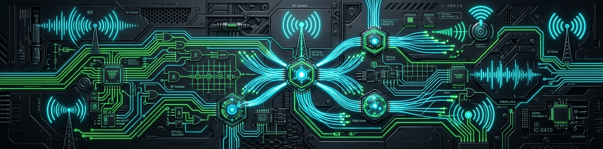

<div align="center">


 

  <!-- NOME NO TOPO EM BRANCO -->
  <a href="https://git.io/typing-svg">
    
  </a>

  

  <br/><br/>

  
  <!-- SUBTÍTULO DIGITADO ESTILO DEV (CIANO) COM ÍCONES -->
<a href="https://git.io/typing-svg">
  
</a>

  <br/><br/>

  <!-- BADGES DE CONTATO & CREDENCIAIS -->
  <p align="center">
    <a href="mailto:ewertonbarbosa90@gmail.com">
      
    </a>
    <a href="mailto:ewerton.nascimento@academico.ifpb.edu.br">
      
    </a>
    <a href="https://instagram.com/ewerton.b.n.amaro" target="_blank">
      
    </a>
    
    
  </p>

</div>

---

### ⚡ Sobre Mim


 

> 💬 *“Integrando a precisão da Engenharia Elétrica, a conectividade da Telemática e a flexibilidade do Software para construir soluções inteligentes e escaláveis.”*

<br/>

<table>
  <tr>
    <td width="50%" valign="top">
      <h4>📍 Atuação & Interesses</h4>
      <ul>
        <li>🔭 <b>Atualmente:</b> Projetos de automação inteligente, iluminação, climatização e sonorização técnica na <b>Domotic</b>.</li>
        <li>🎯 <b>Foco de Estudo:</b> Redes 5G, Segurança da Informação, Automação Smart (IoT) e Arquitetura de Sistemas.</li>
        <li>💡 <b>Diferencial:</b> Perfil híbrido com domínio abrangente do hardware/potência ao desenvolvimento de software.</li>
        <li>📍 <b>Localização:</b> Campina Grande, PB - Brasil</li>
      </ul>
    </td>
    <td width="50%" valign="top">
      <h4>🎓 Formação & Credenciais</h4>
      <ul>
        <li>🎓 <b>Engenharia Elétrica</b> — <i>UFCG</i> (Bacharelado)</li>
        <li>🎓 <b>Telemática</b> — <i>IFPB</i> (Graduação)</li>
        <li>⚡ <b>Técnico em Eletroeletrônica</b> — <i>SENAI</i></li>
        <li>💻 <b>Técnico em Informática</b> — <i>IFPB</i></li>
        <li>📜 <b>Normas & Certificados:</b> NR10 • NR35 • Redes 5G</li>
      </ul>
    </td>
  </tr>
</table>

---

### 🛠️ Tech Stack & Domínio Técnico

<div align="center">

| Categoria | Tecnologias, Softwares & Ferramentas |
| :--- | :--- |
| **Linguagens & Dados** |    |
| **Engenharia & CAD** |    |
| **Redes & Automação** |    |
| **Dev Tools & Sistemas** |    |

</div>

---

### 💼 Experiência & Projetos Práticos

```text
⚡ Domotic (2025 - Presente)
└── Estágio em Engenharia Elétrica (Automação & Sonorização)
    • Programação, configuração e integração de iluminação, áudio e climatização.

🏥 TEC Saúde / HUAC (2022)
└── Auxiliar Técnico em Engenharia Clínica
    • Manutenção, calibração e suporte técnico em equipamentos eletromédicos hospitalares.

🔌 Engeselt Engenharia e Serviços (2021)
└── Estágio em Engenharia Elétrica (Média Tensão)
    • Elaboração e dimensionamento de projetos elétricos em média tensão e redes de distribuição.